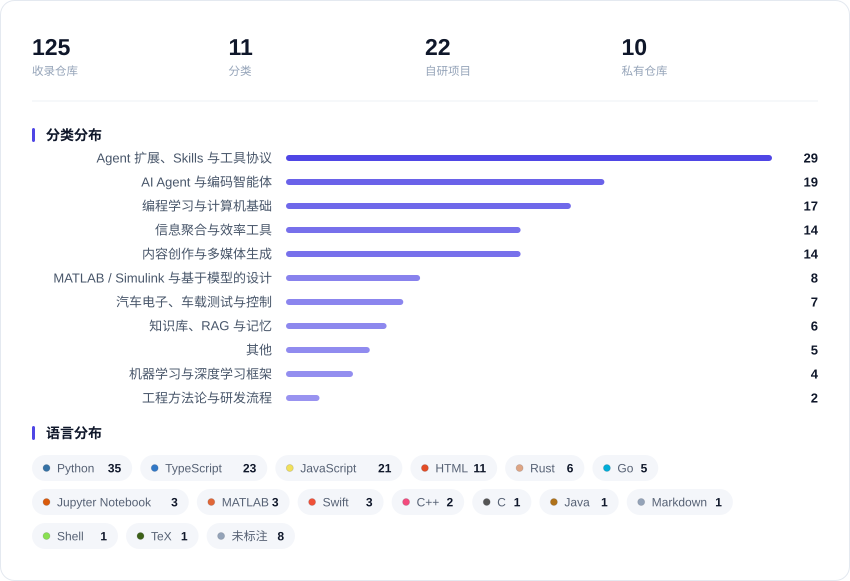

# Starred Toolbox

> 我在 GitHub 星标的工具与资源归档。收录来源只有一个：**我的 Star**。
> 未经星标的内容不会出现在这里；归类与解读由脚本自动生成。

10 个私有仓库仅公开名称、描述与链接等基本信息，代码与文件内容不对外释放，点击链接需要对应的访问权限。

<picture>
  <source media="(prefers-color-scheme: dark)" srcset="assets/overview-dark.svg">
  
</picture>

## 目录

<table width="100%">
<tr><td width="320"><a href="#ai-agent-与编码智能体">AI Agent 与编码智能体</a></td><td width="60" align="right">23</td><td width="320"><a href="#agent-扩展skills-与工具协议">Agent 扩展、Skills 与工具协议</a></td><td width="60" align="right">33</td></tr>
<tr><td width="320"><a href="#知识库rag-与记忆">知识库、RAG 与记忆</a></td><td width="60" align="right">8</td><td width="320"><a href="#matlab-simulink-与基于模型的设计">MATLAB / Simulink 与基于模型的设计</a></td><td width="60" align="right">8</td></tr>
<tr><td width="320"><a href="#汽车电子车载测试与控制">汽车电子、车载测试与控制</a></td><td width="60" align="right">7</td><td width="320"><a href="#内容创作与多媒体生成">内容创作与多媒体生成</a></td><td width="60" align="right">14</td></tr>
<tr><td width="320"><a href="#信息聚合与效率工具">信息聚合与效率工具</a></td><td width="60" align="right">15</td><td width="320"><a href="#编程学习与计算机基础">编程学习与计算机基础</a></td><td width="60" align="right">18</td></tr>
<tr><td width="320"><a href="#机器学习与深度学习框架">机器学习与深度学习框架</a></td><td width="60" align="right">4</td><td width="320"><a href="#工程方法论与研发流程">工程方法论与研发流程</a></td><td width="60" align="right">2</td></tr>
<tr><td width="320"><a href="#其他">其他</a></td><td width="60" align="right">6</td><td width="320"></td><td width="60"></td></tr>
</table>

另有 [我的自研项目](#我的自研项目) 快捷索引，共 22 个。

## 最近加入

| 仓库 | 分类 | 语言 | 星标于 |
| :--- | :--- | :--- | ---: |
| [affaan-m/ECC](https://github.com/affaan-m/ECC) | Agent 扩展、Skills 与工具协议 | JavaScript | 2026-10-31 |
| [milind-soni/OpenMausBot](https://github.com/milind-soni/OpenMausBot) | AI Agent 与编码智能体 | TypeScript | 2026-10-30 |
| [dw-dengwei/daily-arXiv-ai-enhanced](https://github.com/dw-dengwei/daily-arXiv-ai-enhanced) | 信息聚合与效率工具 | JavaScript | 2026-10-30 |
| [chaitin/PandaWiki](https://github.com/chaitin/PandaWiki) | 知识库、RAG 与记忆 | TypeScript | 2026-10-30 |
| [cathrynlavery/diagram-design](https://github.com/cathrynlavery/diagram-design) | Agent 扩展、Skills 与工具协议 | HTML | 2026-10-30 |

## AI Agent 与编码智能体

23 个 · [返回目录](#目录)

- **[deepseek-ai/deepseek-harness](https://github.com/deepseek-ai/deepseek-harness)** TypeScript · ★ 266.9k
  插件化的 DeepSeek 智能体运行时，一切能力皆以插件形式接入。
  想基于 DeepSeek 模型搭建可扩展的编码智能体时。
- **[Significant-Gravitas/AutoGPT](https://github.com/Significant-Gravitas/AutoGPT)** Python · ★ 187.8k
  可自主拆解并执行任务的开源 AI 智能体框架。
  想研究自主 Agent 的早期实现思路时。
- **[stablyai/orca](https://github.com/stablyai/orca)** TypeScript · ★ 111.3k
  多编码智能体编排平台，可在桌面、移动与远程运行多个 Agent。
  需要同时调度 Claude Code 等多个编码 Agent 并统一管理时。
- **[OpenHands/OpenHands](https://github.com/OpenHands/OpenHands)** TypeScript · ★ 92.3k
  可自主完成编码、调试与多步开发任务的 AI 智能体平台。
  需要让 AI 独立接手开发任务、减少人工逐步操作时。
- **[666ghj/MiroFish](https://github.com/666ghj/MiroFish)** Python · ★ 82.9k
  通用群体智能引擎，用于多主体行为建模与预测。
  需要做群体行为仿真或预测类建模时。
- **[alibaba/open-code-review](https://github.com/alibaba/open-code-review)** Go · ★ 49.1k
  结合确定性流水线与 LLM Agent 的代码审查工具，支持行级评论与多语言规则集。
  需要在 CI 或本地对仓库做自动化代码审查并定位具体代码行时。
- **[THU-MAIC/OpenMAIC](https://github.com/THU-MAIC/OpenMAIC)** TypeScript · ★ 42k
  多智能体驱动的交互式课堂，一键生成沉浸式学习体验。
  关注多智能体在教育场景如何落地时。
- **[codewhale-hq/Codewhale](https://github.com/codewhale-hq/Codewhale)** Rust · ★ 41.2k
  用 Rust 编写的开源终端编码智能体，支持多模型与多智能体编排。
  需要在本地终端运行、可自行部署并接入自有模型的编码 Agent 时。
- **[can1357/oh-my-pi](https://github.com/can1357/oh-my-pi)** TypeScript · ★ 37.3k
  集成 IDE 能力的终端编码智能体，支持多模型提供商与 MCP。
  需要在终端里用自有订阅驱动编码 Agent 并接入编辑器时。
- **[AndyMik90/Aperant](https://github.com/AndyMik90/Aperant)** TypeScript · ★ 14.6k
  支持跨多个会话自主推进任务的 AI 编码智能体。
  需要 Agent 在长周期任务上持续工作、而不是单轮对话时。
- **[milind-soni/OpenMausBot](https://github.com/milind-soni/OpenMausBot)** TypeScript · ★ 8.9k
  开源自托管的 AI 智能体平台，为机器人提供可操作的虚拟机环境。
  需要自建可让智能体在虚拟机中执行计算机操作任务的环境时。
- **[zai-org/ZCode](https://github.com/zai-org/ZCode)** TypeScript · ★ 8.4k
  Z.ai 推出的编码智能体运行框架，支持扩展。
  需要接入或试用 Z.ai 的编码 Agent 能力时。
- **[vastsa/PI-Desktop](https://github.com/vastsa/PI-Desktop)** TypeScript · ★ 7.5k
  本地优先的 AI 编码智能体桌面应用，含 Rust 核心与可安装插件。
  希望在本机运行可扩展、数据不外传的编码 Agent 桌面端时。
- **[KunAgent/Kun](https://github.com/KunAgent/Kun)** TypeScript · ★ 6.3k
  本地优先的 AI 智能体工作台，覆盖编码、写作、设计与研究，统一 GUI 与 TUI 运行时。
  想要一个统一入口承载多种 Agent 任务、且数据留在本机时。
- **[Fei2411/DS-Bot](https://github.com/Fei2411/DS-Bot)** JavaScript · ★ 4.7k
  面向 DeepSeek Harness 的长期运行多机器人团队，支持机器人互发消息与群聊。
  想搭建多个长期在线、可互相协作对话的机器人时。
- **[nano-muse/nanoMuse](https://github.com/nano-muse/nanoMuse)** Swift · ★ 2.9k
  跨手机、桌面与浏览器的开源个人智能体，可执行任务并保留记忆。
  想要一个跨设备运行、能记住你并在不可逆操作前确认的个人 Agent 时。
- **[ccch1mneyyy/dsh-Go](https://github.com/ccch1mneyyy/dsh-Go)** Dart · ★ 2.9k
  将 DeepSeek Harness 编码智能体移植到手机端运行的 Flutter 应用。
  需要在手机上运行编码 Agent 或远程操控电脑上的 Agent 时。
- **[zqiren/Orbital](https://github.com/zqiren/Orbital)** Python · ★ 971
  面向自主智能体的编排与管理框架，强调上下文归用户所有、智能体可替换。
  需要搭建多智能体协作系统并自行掌控上下文与记忆时。
- **[abcwyc/pi-agent-desktop](https://github.com/abcwyc/pi-agent-desktop)** TypeScript · ★ 872
  跨平台桌面端 AI 编码智能体，无需配置环境或使用终端命令即可开始编码。
  希望以桌面应用形式使用编码 Agent、不想折腾命令行环境时。
- **[sandroandric/AgentHandover](https://github.com/sandroandric/AgentHandover)** Python · ★ 702
  观察用户操作习惯，转成可自改进的技能并交接给编码智能体。
  想让 Agent 学会你的固定工作方式、不必每次重复交代时。
- **[yicheng47/runner](https://github.com/yicheng47/runner)** Rust · ★ 422
  在真实终端中让多个编码智能体协作完成同一任务的编排工具。
  希望同时调度 Claude Code、Codex 等多个编码 Agent 处理同一任务时。
- **[suzike/agentic-island](https://github.com/suzike/agentic-island)** `自研` TypeScript · ★ 12
  常驻 Windows 顶部的 AI 编码智能体监控与审批面板，兼作个人工作台。
  想让多个 Agent 的运行状态与待审批请求集中可见时。
- **[suzike-dev/IntentOS](https://github.com/suzike-dev/IntentOS)** `私有` `自研` Python · ★ 1
  规范驱动的嵌入式研发平台，含多 Agent 协作与门禁治理。
  想用 Spec 驱动方式组织嵌入式软件研发流程时。

## Agent 扩展、Skills 与工具协议

33 个 · [返回目录](#目录)

- **[morluto/rea](https://github.com/morluto/rea)** TypeScript · ★ 413.1k
  为 Agent 提供逆向工程能力的工具集，可分析应用行为与原生二进制文件。
  需要让编码 Agent 借助 Ghidra 等工具做二进制反汇编与静态分析时。
- **[mattpocock/skills](https://github.com/mattpocock/skills)** Shell · ★ 307.7k
  作者从个人 .agents 目录整理出的面向工程师的 Agent Skills 集合。
  想参考他人实际使用的编码 Agent 技能配置时。
- **[affaan-m/ECC](https://github.com/affaan-m/ECC)** JavaScript · ★ 293.5k
  为 Claude Code、Codex 等编码智能体提供技能、记忆与安全扩展的优化框架。
  需要给现有编码 Agent 补充技能、记忆与安全约束时。
- **[DietrichGebert/ponytail](https://github.com/DietrichGebert/ponytail)** JavaScript · ★ 181.1k
  让 AI 编码代理遵循 YAGNI、少写代码的 Agent 技能插件。
  希望代理减少冗余代码、避免过度设计时。
- **[nextlevelbuilder/ui-ux-pro-max-skill](https://github.com/nextlevelbuilder/ui-ux-pro-max-skill)** Python · ★ 143.1k
  为 AI 代理提供多平台专业 UI/UX 设计能力的技能。
  让编码代理生成界面时具备设计规范与布局能力时。
- **[addyosmani/agent-skills](https://github.com/addyosmani/agent-skills)** JavaScript · ★ 112k
  面向 AI 编码智能体的生产级工程技能集合。
  想给 Agent 补上成熟工程实践、减少低级失误时。
- **[Leonxlnx/taste-skill](https://github.com/Leonxlnx/taste-skill)** JavaScript · ★ 106.5k
  用于约束 AI 生成内容风格、避免通用化设计的 Agent 技能。
  觉得代理产出的前端设计千篇一律、想改善审美时。
- **[cathrynlavery/diagram-design](https://github.com/cathrynlavery/diagram-design)** HTML · ★ 63.3k
  面向多种编码 Agent 的图表设计技能集，输出自包含 HTML 与 SVG 图。
  想让编码 Agent 按统一风格生成架构图或数据可视化时。
- **[alchaincyf/huashu-design](https://github.com/alchaincyf/huashu-design)** HTML · ★ 28.2k
  面向编码 Agent 的 HTML 原生设计技能，可生成网页、原型、PPTX 与信息图。
  需要在 Claude Code、Cursor 等 Agent 中直接产出可交付设计稿时。
- **[yetone/magpie](https://github.com/yetone/magpie)** Go · ★ 26.5k
  在 macOS 菜单栏为编码 Agent 切换与配置不同大模型后端的工具。
  想让 Codex、Claude Code 等 Agent 接入 DeepSeek、Kimi 等模型时。
- **[wheresryan22/anatomy](https://github.com/wheresryan22/anatomy)** JavaScript · ★ 23.1k
  将技术构想转为可交互等距机械图的 Claude Code 技能，输出 SVG 与可选 WebGL 着色器。
  需要为文档、文章或落地页快速生成机械结构示意图时。
- **[citrolabs/ego-lite](https://github.com/citrolabs/ego-lite)** JavaScript · ★ 20.9k
  为 AI 智能体提供浏览器自动化能力的工具，可共享已登录的浏览器状态。
  需要让 Codex 或 Claude Code 等智能体操作浏览器且不影响自己正常使用时。
- **[dsh-market/dsh-market](https://github.com/dsh-market/dsh-market)** TypeScript · ★ 9.9k
  DeepSeek Harness 的可视化插件市场，支持浏览、搜索与一键安装插件。
  需要为 DeepSeek Harness 查找并安装插件、扩展其能力时。
- **[Tencent/BrowserSkill](https://github.com/Tencent/BrowserSkill)** TypeScript · ★ 9.8k
  让 AI Agent 使用真实已登录浏览器的 CLI 与扩展工具。
  希望 Agent 在后台自动化浏览器而不打断当前工作时。
- **[jakubkrehel/skills](https://github.com/jakubkrehel/skills)** Markdown · ★ 9.4k
  一组用于辅助构建界面设计的 Agent Skills 集合。
  让编码 Agent 按规范产出界面代码或设计稿时使用。
- **[Jakeschincariol/replica-skill](https://github.com/Jakeschincariol/replica-skill)** Python · ★ 6.7k
  一套面向 Claude 的 Agent Skills 集合，用于逆向分析、重建并测试现有应用。
  想让编码 Agent 按固定流程复刻某个应用或排查其缺陷时。
- **[yang0/handraw-style](https://github.com/yang0/handraw-style)** HTML · ★ 6.7k
  提供手绘风格编号画廊与双语提示词的 Agent Skill 资源。
  需要让 Agent 生成手绘风格图像或提示词时使用。
- **[alchaincyf/huashu-art-motion](https://github.com/alchaincyf/huashu-art-motion)** JavaScript · ★ 5.8k
  提供35种艺术风格与9种解说语法的动画生成 Skill，用代码驱动画面动效。
  需要为 Agent 增加艺术动画生成能力，或制作带解说的动态视觉内容时。
- **[Tencent/teamai-cli](https://github.com/Tencent/teamai-cli)** TypeScript · ★ 5.7k
  面向团队场景的 AI 命令行工具。
  官方描述较简短，具体用法待补充。
- **[JimLiu/baoyu-design](https://github.com/JimLiu/baoyu-design)** JavaScript · ★ 5.6k
  以 Agent Skill 形式在本地生成 UI 原型与设计稿的扩展。
  在 Cursor 或 Claude Code 中需要快速产出界面原型与线框图时。
- **[omdsh-dev/DSH-better-sidebar](https://github.com/omdsh-dev/DSH-better-sidebar)** TypeScript · ★ 4.8k
  可扩展的侧边栏底座，内置文件编辑、终端、Git 与子代理页面。
  想给 DeepSeek Harness 增加自定义侧边栏能力时。
- **[MarkusPfundstein/mcp-obsidian](https://github.com/MarkusPfundstein/mcp-obsidian)** Python · ★ 4.5k
  通过 Obsidian 本地 REST API 插件读写笔记的 MCP 服务器。
  希望让 AI 助手直接检索和编辑本地 Obsidian 笔记库时。
- **[NarratorAI-Studio/narrator-ai-cli-skill](https://github.com/NarratorAI-Studio/narrator-ai-cli-skill)** ★ 3.1k
  封装 narrator-ai-cli 的 Agent Skill，供 Claude、Codex 等工具调用生成视频解说。
  想让编码 Agent 直接调用命令行完成影视解说或短剧配音生成时。
- **[yaojingang/yao-meta-skill](https://github.com/yaojingang/yao-meta-skill)** Python · ★ 2.7k
  面向可复用 Agent Skills 的工程化、评估、治理与可移植性框架。
  需要为团队建立 Agent 技能规范、评估与治理流程时。
- **[shaobeichen/dsh-pocket](https://github.com/shaobeichen/dsh-pocket)** JavaScript · ★ 2.6k
  把电脑上运行的 DeepSeek Harness Web 服务通过二维码同步到手机访问的插件。
  需要在手机上远程查看和操作电脑端 DeepSeek Harness 时使用。
- **[alchaincyf/huashu-motion](https://github.com/alchaincyf/huashu-motion)** JavaScript · ★ 1.9k
  为编码 Agent 提供生成商业级产品宣传片的技能包，含配乐与画面局部修改。
  需要让编码 Agent 直接产出产品宣传视频并按画面指定位置修改时。
- **[arjun988/blender-skills](https://github.com/arjun988/blender-skills)** TypeScript · ★ 1.6k
  面向 Blender 的 Agent Skills 集合，通过 MCP 串联从粗模到引擎导出的制作流程。
  用 Cursor 或 Claude Code 等 Agent 辅助 Blender 建模与导出时，可加载这套技能。
- **[imxv/Pretty-mermaid-skills](https://github.com/imxv/Pretty-mermaid-skills)** JavaScript · ★ 1.6k
  为 AI Agent 提供生成并渲染 Mermaid 图表为 SVG 或终端 ASCII 的技能包。
  需要让编码 Agent 自动输出流程图、架构图等文档配图时。
- **[alchaincyf/huashu-chrome](https://github.com/alchaincyf/huashu-chrome)** JavaScript · ★ 551
  通过 MCP 与 Chrome 扩展让 AI Agent 操控带登录态的浏览器。
  需要让 Agent 操作已登录的网页、复用现有会话时。
- **[alchaincyf/huashu-report](https://github.com/alchaincyf/huashu-report)** Python · ★ 478
  面向机构级研究报告生成的 Agent Skill，含报告原型与图表流水线。
  需要让 Agent 按规范产出结构化研究报告与图表时。
- **[oil-oil/dsh-oil-ui](https://github.com/oil-oil/dsh-oil-ui)** JavaScript · ★ 183
  Oil UI 的 DeepSeek Harness 原生插件，可自动切换本地安装的 Oil UI Pro。
  在 DeepSeek Harness 中使用 Oil UI 并需要自动切换本地 Pro 版本时。
- **[suzike/dsh-freestyle-theme](https://github.com/suzike/dsh-freestyle-theme)** `自研` TypeScript · ★ 12
  为 DeepSeek Harness 提供 OKLCH 主题与可视化主题设计器的插件，支持跨重启持久化。
  需要自定义 DeepSeek Harness 界面配色并保存主题设置时使用。
- **[suzike-dev/polarion-mcp-server](https://github.com/suzike-dev/polarion-mcp-server)** `私有` `自研` TypeScript · ★ 1
  面向 Polarion SOAP 接口的带权限管控 MCP server。
  想让 AI 安全访问 Polarion 需求管理数据时。

## 知识库、RAG 与记忆

8 个 · [返回目录](#目录)

- **[Tencent/WeKnora](https://github.com/Tencent/WeKnora)** Go · ★ 36.1k
  把原始文档转成可检索的 RAG、推理智能体与自维护 Wiki 的开源知识平台。
  需要把私有文档沉淀成可问答知识库、且希望自行部署时。
- **[opendataloader-project/opendataloader-pdf](https://github.com/opendataloader-project/opendataloader-pdf)** Java · ★ 30.1k
  开源 PDF 解析工具，将 PDF 转为带坐标、表格与标记的 Markdown、JSON 等结构化数据。
  需要把 PDF 文档转成可检索结构化数据以构建 RAG 或做无障碍处理时。
- **[nashsu/llm_wiki](https://github.com/nashsu/llm_wiki)** TypeScript · ★ 21.2k
  把文档自动整理成互链知识库的跨平台桌面应用。
  同上，两者描述一致，此为星标数更高的版本。
- **[chaitin/PandaWiki](https://github.com/chaitin/PandaWiki)** TypeScript · ★ 10.4k
  大模型驱动的开源知识库系统，支持产品文档、技术文档、FAQ 与博客搭建。
  需要自建带 AI 问答与搜索能力的团队文档或知识库时。
- **[xerrors/Yuxi](https://github.com/xerrors/Yuxi)** Python · ★ 7.6k
  可私有部署的多租户知识智能体平台，整合 RAG、知识图谱与多智能体。
  需要在自有服务器上搭建带权限管理的企业知识问答与检索系统时。
- **[tianma-if/edgeever](https://github.com/tianma-if/edgeever)** TypeScript · ★ 3.1k
  支持即时同步与原生 MCP 的 AI 知识库，可替代印象笔记或 Obsidian。
  需要自建或部署在 Cloudflare 上的个人笔记与知识管理库时。
- **[zenghui-li/yuxi](https://github.com/zenghui-li/yuxi)** Python · ★ 184
  集成 LightRAG 知识库与知识图谱的多租户 Agent Harness 平台。
  需要为自己的 Agent 搭一套带知识库与图谱的后端时。
- **[suzike/llm_wiki](https://github.com/suzike/llm_wiki)** `自研` TypeScript · ★ 2
  把文档自动整理成互链知识库的跨平台桌面应用。
  想在本机把零散文档变成可检索的 wiki 时。

## MATLAB / Simulink 与基于模型的设计

8 个 · [返回目录](#目录)

- **[matlab/matlab-mcp-server](https://github.com/matlab/matlab-mcp-server)** Go · ★ 1.7k
  MathWorks 官方 MCP server，让 AI 应用直接运行 MATLAB。
  想让 Claude 等 AI 直接执行 MATLAB 代码时。
- **[matlab/simulink-agentic-toolkit](https://github.com/matlab/simulink-agentic-toolkit)** HTML · ★ 1.3k
  让 AI 智能体具备 Simulink 与基于模型设计工作能力的官方工具集。
  想让 Agent 参与 Simulink 建模与 MBD 流程时。
- **[matlab/matlab-agentic-toolkit](https://github.com/matlab/matlab-agentic-toolkit)** MATLAB · ★ 1.2k
  把 MATLAB 能力封装给 AI 智能体使用的官方工具集。
  需要让 Agent 稳定调用 MATLAB 工程能力时。
- **[matlab/agent-skills-playground](https://github.com/matlab/agent-skills-playground)** HTML · ★ 193
  面向 MATLAB/Simulink 的 Agent Skills 原型与演示沙箱。
  想为 MATLAB 工作流编写自定义 Agent 技能时的起点。
- **[suzike/DeepSeekMatlabCopilot](https://github.com/suzike/DeepSeekMatlabCopilot)** `自研` MATLAB · ★ 11
  面向 MATLAB 工程流程的 DeepSeek 辅助工具。
  想在 MATLAB 工作中接入 DeepSeek 时。
- **[suzike-dev/Matlab-Simulink-SuperAgent](https://github.com/suzike-dev/Matlab-Simulink-SuperAgent)** `私有` `自研` HTML · ★ 1
  内嵌进 MATLAB/Simulink 界面的 AI 智能体，支持多种模型后端。
  想在建模环境里直接调用 AI 辅助、不来回切换窗口时。
- **[suzike-dev/model-code-to-srs](https://github.com/suzike-dev/model-code-to-srs)** `私有` `自研` Python · ★ 1
  从 Simulink/Stateflow 模型与生成代码反推中文软件需求规格的 Agent Skill。
  需要为已完成的模型补齐可评审 SRS 文档时。
- **[suzike-dev/terminal-in-matlab](https://github.com/suzike-dev/terminal-in-matlab)** `私有` `自研` MATLAB · ★ 1
  在 MATLAB 环境中提供终端功能的工具仓库。
  需要在 MATLAB 界面内直接执行命令行操作时。

## 汽车电子、车载测试与控制

7 个 · [返回目录](#目录)

- **[pms67/PID](https://github.com/pms67/PID)** C · ★ 948
  C 语言实现的 PID 控制器。
  需要在嵌入式项目中集成 PID 控制时。
- **[ecubus/EcuBus-Pro](https://github.com/ecubus/EcuBus-Pro)** C++ · ★ 899
  覆盖 UDS、CAN-TP、DOIP、LIN 与类 CAPL 脚本的汽车 ECU 开发与 HIL 测试工具。
  做 ECU 诊断、总线通信或 HIL 测试、又不想依赖商业工具链时。
- **[auto-py-utils/py-canoe](https://github.com/auto-py-utils/py-canoe)** Python · ★ 120
  用于控制 Vector CANoe 的 Python 包。
  想用 Python 脚本驱动 CANoe 时。
- **[suzike-dev/Agent2Canape](https://github.com/suzike-dev/Agent2Canape)** `私有` `自研` Python · ★ 1
  面向整车工程任务的 Vector CANape 自动化、分析与安全编排平台。
  需要把标定与测量流程脚本化时。
- **[suzike-dev/Agent2Canoe](https://github.com/suzike-dev/Agent2Canoe)** `私有` `自研` Python · ★ 1
  面向 Vector CANoe 的自然语言与 AI Agent 自动化平台。
  想让 AI 驱动 CANoe 测试流程时。
- **[suzike-dev/Intelligent-Calibration-platform](https://github.com/suzike-dev/Intelligent-Calibration-platform)** `私有` `自研` Python · ★ 1
  面向智能热管理与空调舒适性的实车标定平台。
  需要管理热管理标定数据与试验流程时。
- **[suzike-dev/Vehicle-Thermal-LLM-MultiAgent](https://github.com/suzike-dev/Vehicle-Thermal-LLM-MultiAgent)** `私有` `自研` Python · ★ 1
  面向汽车空调热舒适的大模型驱动多智能体系统。
  研究大模型在热舒适控制中的应用时。

## 内容创作与多媒体生成

14 个 · [返回目录](#目录)

- **[AUTOMATIC1111/stable-diffusion-webui](https://github.com/AUTOMATIC1111/stable-diffusion-webui)** Python · ★ 165.2k
  本地部署的 Stable Diffusion 图像生成 Web 界面。
  想在本机跑文生图、且需要完整参数控制与插件生态时。
- **[harry0703/MoneyPrinterTurbo](https://github.com/harry0703/MoneyPrinterTurbo)** Python · ★ 136.7k
  根据主题或关键词自动生成高清短视频的 AI 工作流工具。
  需要批量制作短视频素材、自动配音加字幕时。
- **[tt-a1i/archify](https://github.com/tt-a1i/archify)** JavaScript · ★ 91.9k
  生成架构图、流程图、时序图与数据流图的自包含 HTML Agent Skill。
  需要带动效、可导出、可验证的技术图表时。
- **[storytold/photocraft](https://github.com/storytold/photocraft)** Rust · ★ 75.3k
  用纯 Rust 从零编写的开源照片编辑软件。
  需要对图片进行编辑处理，并希望使用开源本地工具时。
- **[ATH-MaaS/Pixelle-Video](https://github.com/ATH-MaaS/Pixelle-Video)** Python · ★ 29.6k
  AI 全自动短视频生成引擎。
  需要批量产出短视频内容时。
- **[easydiffusion/easydiffusion](https://github.com/easydiffusion/easydiffusion)** JavaScript · ★ 10.5k
  一键式本地 AI 绘图工具，面向无技术背景用户。
  想零配置体验本地图像生成时。
- **[Cocoon-AI/architecture-diagram-generator](https://github.com/Cocoon-AI/architecture-diagram-generator)** HTML · ★ 7.5k
  把系统架构描述生成独立 HTML/SVG 架构图的 Claude Skill。
  需要快速产出可分享的架构图、又不想手绘时。
- **[ZJU-REAL/Easel](https://github.com/ZJU-REAL/Easel)** Python · ★ 4.2k
  面向社交媒体的开源 AI 智能体，可发现热点、生成内容并一键发布到多平台。
  需要批量产出并分发小红书、抖音、知乎等平台内容时。
- **[LearnPrompt/awesome-seedance](https://github.com/LearnPrompt/awesome-seedance)** JavaScript · ★ 2.4k
  Seedance 视频生成提示词库，含案例、模板与可安装的 AI 视频 Skills。
  需要用 Seedance 生成视频并参考现成提示词模板时。
- **[JimLiu/baocut](https://github.com/JimLiu/baocut)** TypeScript · ★ 1.6k
  带可编辑时间线的 AI 视频处理工具，支持转写、字幕、翻译、配音、剪辑与动画。
  需要为视频批量生成字幕、翻译配音或做时间线剪辑时。
- **[threerocks/sweety-handdraw-video](https://github.com/threerocks/sweety-handdraw-video)** JavaScript · ★ 967
  从主题或文章生成手绘讲解视频，含描线、逐字书写与配音流程。
  需要把文章或主题快速转成手绘风格讲解视频时。
- **[Aryanutkarsh/SeeCode](https://github.com/Aryanutkarsh/SeeCode)** JavaScript · ★ 749
  根据简短 JSON 规格生成可交互动画架构图的工具，面向编码智能体。
  需要把系统设计或代码结构快速转成可探索的动画图表时。
- **[guanmo-ai/design-style](https://github.com/guanmo-ai/design-style)** Python · ★ 148
  每日分享一种设计风格，提供动效短片、风格图与制作指南并开放源码。
  需要参考设计风格或制作动效短片、风格图素材时使用。
- **[suzike/nanju-write-paper](https://github.com/suzike/nanju-write-paper)** `自研` HTML · ★ 7
  从选题到成稿的写作流水线 Skill，含多 Agent 调研、五角色审查与多尺寸卡片版式输出。
  需要把技术选题批量产出为长文与公众号/PDF 版式时。

## 信息聚合与效率工具

15 个 · [返回目录](#目录)

- **[sansan0/TrendRadar](https://github.com/sansan0/TrendRadar)** Python · ★ 63.3k
  聚合多平台热点与 RSS 的 AI 舆情与趋势监控工具，支持多通道推送。
  想用关键词订阅热点并定时收到简报时。
- **[timqian/chinese-independent-blogs](https://github.com/timqian/chinese-independent-blogs)** JavaScript · ★ 24.4k
  收录中文独立博客的列表仓库，提供订阅源与站点索引。
  想找中文独立博客内容或为自己的阅读器补充 RSS 源时。
- **[genspark-ai/genoffice](https://github.com/genspark-ai/genoffice)** TypeScript · ★ 11.4k
  开源 AI 办公套件，含文档、表格、幻灯片与 PDF 编辑器及本地文件读写命令行工具。
  需要本地用自有密钥让编码智能体创建和编辑 Office 文件时。
- **[guaguastandup/zotero-pdf2zh](https://github.com/guaguastandup/zotero-pdf2zh)** Python · ★ 8k
  Zotero 的 PDF 中文翻译插件。
  需要读英文论文并要中文对照时。
- **[Kuddev/pebrel](https://github.com/Kuddev/pebrel)** Rust · ★ 3.7k
  面向 Windows 的 GPU 加速终端模拟器，支持 SSH、分屏与会话保持。
  需要在 Windows 上使用带分屏和 SSH 的终端跑 AI CLI 时。
- **[dw-dengwei/daily-arXiv-ai-enhanced](https://github.com/dw-dengwei/daily-arXiv-ai-enhanced)** JavaScript · ★ 3k
  每日自动抓取 arXiv 论文并用 AI 生成摘要、以 GitHub Pages 展示的聚合站点。
  需要每天快速浏览 AI 领域新论文摘要、跟踪研究动态时。
- **[alejandrobujan/tendedero](https://github.com/alejandrobujan/tendedero)** Swift · ★ 2.8k
  把每张截图挂到屏幕顶部一条线上的 macOS 小工具。
  需要随手查看最近截图、避免窗口遮挡时使用。
- **[ELY-Open-Source/ElyOffice](https://github.com/ELY-Open-Source/ElyOffice)** Rust · ★ 1.1k
  用 Rust 与 GPUI 构建的离线优先桌面办公套件。
  需要在本地离线处理文档、不依赖云服务的办公场景时。
- **[fuxiaoai/tidings-rss](https://github.com/fuxiaoai/tidings-rss)** Python · ★ 630
  经过筛选与实时校验的 OPML 订阅源合集，覆盖 AI、新闻、研究、播客等。
  需要批量导入 RSS 阅读器、快速搭建信息订阅源时使用。
- **[RoversX/ThinkTerm](https://github.com/RoversX/ThinkTerm)** Rust · ★ 224
  内置多路复用器的终端，关闭后会话继续运行，可跨机器管理 shell 与 AI 智能体。
  需要在桌面、浏览器和 TUI 间切换并保持长时间任务不中断时。
- **[suzike/sunmemo-windows](https://github.com/suzike/sunmemo-windows)** `自研` JavaScript · ★ 6
  本地离线的 Electron 桌面应用，用于记录未完成的想法与待办。
  需要一款不联网、随手记录零散想法和待办事项的桌面工具时。
- **[suzike/RobinRead](https://github.com/suzike/RobinRead)** `自研` JavaScript · ★ 3
  本地优先、AI 增强的纸感三栏 RSS 阅读器（Windows / Electron）。
  想要不依赖云端的 RSS 阅读体验时。
- **[suzike/starred-toolbox](https://github.com/suzike/starred-toolbox)** `自研` Python · ★ 3
  用 Actions 定时同步并自动归类解读个人 GitHub 星标仓库的归档工具。
  想把自己的 GitHub Star 整理成可检索、带分类说明的个人知识库时。
- **[suzike/juzhen-dock](https://github.com/suzike/juzhen-dock)** `自研` HTML · ★ 2
  常驻 Windows 屏幕右侧的桌面入口工具，同一份 UI 源码可产出浏览器原型与 Electron 桌面版。
  需要在 Windows 桌面侧边常驻一个快速启动入口，并兼顾浏览器预览与桌面打包时。
- **[suzike/Office-Viewer](https://github.com/suzike/Office-Viewer)** `自研` TypeScript · ★ 2
  Windows 桌面文档查看与编辑器，支持 Office、Markdown、压缩包与 Git 历史。
  想不装 Office 也能快速查看和编辑文档时。

## 编程学习与计算机基础

18 个 · [返回目录](#目录)

- **[sindresorhus/awesome](https://github.com/sindresorhus/awesome)** ★ 527.6k
  汇集各类主题优质资源清单的 Awesome 列表总目录仓库。
  想按主题查找学习资料、工具或开源项目索引时。
- **[ossu/computer-science](https://github.com/ossu/computer-science)** HTML · ★ 210.6k
  免费的计算机科学自学课程路线。
  想按完整课程体系自学 CS 时。
- **[jackfrued/Python-100-Days](https://github.com/jackfrued/Python-100-Days)** Jupyter Notebook · ★ 187.6k
  从入门到进阶的 Python 系统教程，按天组织。
  想按天推进、系统学完 Python 时。
- **[521xueweihan/HelloGitHub](https://github.com/521xueweihan/HelloGitHub)** Python · ★ 185.9k
  面向入门者的开源项目推荐月刊。
  想发现适合上手的开源项目时。
- **[justjavac/free-programming-books-zh_CN](https://github.com/justjavac/free-programming-books-zh_CN)** ★ 119.5k
  免费计算机技术中文书籍索引。
  需要找中文技术书时。
- **[HKUDS/DeepTutor](https://github.com/HKUDS/DeepTutor)** Python · ★ 52k
  基于多智能体与 RAG 的个性化长期学习辅导系统。
  想搭建能持续跟踪学习进度并答疑的 AI 辅导工具时。
- **[izackwu/TeachYourselfCS-CN](https://github.com/izackwu/TeachYourselfCS-CN)** ★ 22.2k
  计算机科学自学路线指南的中文翻译。
  想按体系补齐计算机基础、又需要中文材料时。
- **[zergtant/pytorch-handbook](https://github.com/zergtant/pytorch-handbook)** Jupyter Notebook · ★ 21.7k
  PyTorch 入门开源书籍，教程均可运行。
  想系统学习 PyTorch 时。
- **[Yixiaohan/show-me-the-code](https://github.com/Yixiaohan/show-me-the-code)** ★ 13.7k
  Python 练习册，每天一个小程序。
  想通过小练习巩固 Python 基础时。
- **[jikexueyuanwiki/tensorflow-zh](https://github.com/jikexueyuanwiki/tensorflow-zh)** TeX · ★ 12.3k
  TensorFlow 官方文档的中文翻译。
  需要查阅中文 TensorFlow 文档时。
- **[lawlite19/MachineLearning_Python](https://github.com/lawlite19/MachineLearning_Python)** Python · ★ 8.7k
  机器学习算法的 Python 实现合集。
  想对照代码理解经典算法时。
- **[jackzhenguo/python-small-examples](https://github.com/jackzhenguo/python-small-examples)** Python · ★ 8.1k
  Python 实用小例子合集。
  想快速查某个 Python 写法的实例时。
- **[billryan/algorithm-exercise](https://github.com/billryan/algorithm-exercise)** Python · ★ 3.5k
  数据结构与算法题解笔记，含 LeetCode 与 LintCode。
  刷题或复习算法时。
- **[datawhalechina/hugging-llm](https://github.com/datawhalechina/hugging-llm)** Jupyter Notebook · ★ 3.1k
  Datawhale 出品的大模型入门与实践教程。
  想跟着中文教程系统入门大模型时。
- **[datawhalechina/team-learning](https://github.com/datawhalechina/team-learning)** ★ 2.4k
  Datawhale 组队学习计划的资料汇总。
  想跟着组队节奏推进学习时。
- **[yidao620c/core-algorithm](https://github.com/yidao620c/core-algorithm)** Python · ★ 782
  常见算法的 Python 实现集合。
  复习算法实现细节时。
- **[alchaincyf/3d-vibe-coding-handbook](https://github.com/alchaincyf/3d-vibe-coding-handbook)** HTML · ★ 303
  《3D Vibe Coding 手册》配套仓库，含 HTML 书稿、示例源码与资源索引。
  想按教程学习 3D 与 AI 生成建模、并动手跑示例时。
- **[suzike/EmbedSummary](https://github.com/suzike/EmbedSummary)** `自研` ★ 1
  嵌入式开发资源汇总。
  需要嵌入式方向的资料索引时。

## 机器学习与深度学习框架

4 个 · [返回目录](#目录)

- **[tensorflow/models](https://github.com/tensorflow/models)** Python · ★ 77.6k
  TensorFlow 官方模型与示例库。
  想找官方模型实现作参考时。
- **[PaddlePaddle/Paddle](https://github.com/PaddlePaddle/Paddle)** C++ · ★ 24.1k
  百度开源的深度学习框架（飞桨）。
  需要在国产框架上训练与部署模型时。
- **[astaxie/TokenHub](https://github.com/astaxie/TokenHub)** Go · ★ 1.4k
  面向企业的私有 AI 模型访问网关，统一接入并治理模型调用请求。
  企业需要统一管理多家大模型接入、配额与调用审计时。
- **[suzike-dev/AITrain_Platform](https://github.com/suzike-dev/AITrain_Platform)** `私有` `自研` Python · ★ 1
  覆盖 AI 算法开发、训练与部署的研发可视化管理平台。
  需要统一管理算法研发全流程时。

## 工程方法论与研发流程

2 个 · [返回目录](#目录)

- **[xdash/FDE-the-Guidance-Book-of-Forward-Deployed-Engineer](https://github.com/xdash/FDE-the-Guidance-Book-of-Forward-Deployed-Engineer)** ★ 5.4k
  前沿部署工程师（FDE）的从零入门指南。
  想了解 FDE 岗位的能力模型与工作方法时。
- **[huangjia2019/sdd-in-action](https://github.com/huangjia2019/sdd-in-action)** Python · ★ 165
  规范驱动开发的实战手册，覆盖 Claude Code 与 OpenCode 两条路径。
  想系统学习 SDD 如何落地到日常开发时。

## 其他

6 个 · [返回目录](#目录)

- **[eternity4719/HowToLiveBetter](https://github.com/eternity4719/HowToLiveBetter)** HTML · ★ 71.7k
  按性价比排序的循证生活指南，涵盖健康、理财、法律、社保与育儿等主题。
  需要查阅有出处依据的生活决策建议时，可参考其成本收益与证据等级。
- **[HeyPuter/everything](https://github.com/HeyPuter/everything)** JavaScript · ★ 6k
  以开源方式从零重建各类桌面软件的项目集合。
  信息有限，待补充。
- **[Cai-aa/CAE-Agent-Hub](https://github.com/Cai-aa/CAE-Agent-Hub)** Python · ★ 1.2k
  信息有限，待补充。
  信息有限，待补充。
- **[the-snowpear/omp-studio](https://github.com/the-snowpear/omp-studio)** TypeScript · ★ 93
  无描述信息的 TypeScript 项目，用途无法从元数据判断。
  信息有限，待补充。
- **[km-open-lab/SunMemo](https://github.com/km-open-lab/SunMemo)** Swift · ★ 4
  信息有限，无法判断其具体功能与用途。
  信息有限，待补充。
- **[suzike/suzike](https://github.com/suzike/suzike)** `自研` Python · ★ 1
  个人主页 README。
  信息有限，待补充。

## 我的自研项目

以下仓库同时出现在上方对应分类中，此处仅作快捷索引。

| 仓库 | 所属分类 | 仓库 | 所属分类 |
| :--- | :--- | :--- | :--- |
| [suzike-dev/Agent2Canape](https://github.com/suzike-dev/Agent2Canape) | 汽车电子、车载测试与控制 | [suzike-dev/Agent2Canoe](https://github.com/suzike-dev/Agent2Canoe) | 汽车电子、车载测试与控制 |
| [suzike-dev/AITrain_Platform](https://github.com/suzike-dev/AITrain_Platform) | 机器学习与深度学习框架 | [suzike-dev/Intelligent-Calibration-platform](https://github.com/suzike-dev/Intelligent-Calibration-platform) | 汽车电子、车载测试与控制 |
| [suzike-dev/IntentOS](https://github.com/suzike-dev/IntentOS) | AI Agent 与编码智能体 | [suzike-dev/Matlab-Simulink-SuperAgent](https://github.com/suzike-dev/Matlab-Simulink-SuperAgent) | MATLAB / Simulink 与基于模型的设计 |
| [suzike-dev/model-code-to-srs](https://github.com/suzike-dev/model-code-to-srs) | MATLAB / Simulink 与基于模型的设计 | [suzike-dev/polarion-mcp-server](https://github.com/suzike-dev/polarion-mcp-server) | Agent 扩展、Skills 与工具协议 |
| [suzike-dev/terminal-in-matlab](https://github.com/suzike-dev/terminal-in-matlab) | MATLAB / Simulink 与基于模型的设计 | [suzike-dev/Vehicle-Thermal-LLM-MultiAgent](https://github.com/suzike-dev/Vehicle-Thermal-LLM-MultiAgent) | 汽车电子、车载测试与控制 |
| [suzike/agentic-island](https://github.com/suzike/agentic-island) | AI Agent 与编码智能体 | [suzike/DeepSeekMatlabCopilot](https://github.com/suzike/DeepSeekMatlabCopilot) | MATLAB / Simulink 与基于模型的设计 |
| [suzike/dsh-freestyle-theme](https://github.com/suzike/dsh-freestyle-theme) | Agent 扩展、Skills 与工具协议 | [suzike/EmbedSummary](https://github.com/suzike/EmbedSummary) | 编程学习与计算机基础 |
| [suzike/juzhen-dock](https://github.com/suzike/juzhen-dock) | 信息聚合与效率工具 | [suzike/llm_wiki](https://github.com/suzike/llm_wiki) | 知识库、RAG 与记忆 |
| [suzike/nanju-write-paper](https://github.com/suzike/nanju-write-paper) | 内容创作与多媒体生成 | [suzike/Office-Viewer](https://github.com/suzike/Office-Viewer) | 信息聚合与效率工具 |
| [suzike/RobinRead](https://github.com/suzike/RobinRead) | 信息聚合与效率工具 | [suzike/starred-toolbox](https://github.com/suzike/starred-toolbox) | 信息聚合与效率工具 |
| [suzike/sunmemo-windows](https://github.com/suzike/sunmemo-windows) | 信息聚合与效率工具 | [suzike/suzike](https://github.com/suzike/suzike) | 其他 |

---

[返回目录](#目录)

这个归档是怎么运转的

数据更新于 2026-10-31 06:57 UTC

- 唯一来源是本账号的 Star 列表，由 GitHub Actions 每小时定时拉取，不做任何主动发现。
- 新增条目会调用大模型归类并生成「这是什么 / 什么时候用」两句解读；没有配置模型密钥时降级为规则归类。
- 私有仓库只公开名称、描述与链接等元数据，同步脚本从不请求仓库文件、README 正文或代码内容。
- 取消 Star 后，条目会在下次同步时移出列表。

本文件与 `assets/` 下的分布图均由 `scripts/sync_stars.py` 自动生成，请勿手工编辑。

